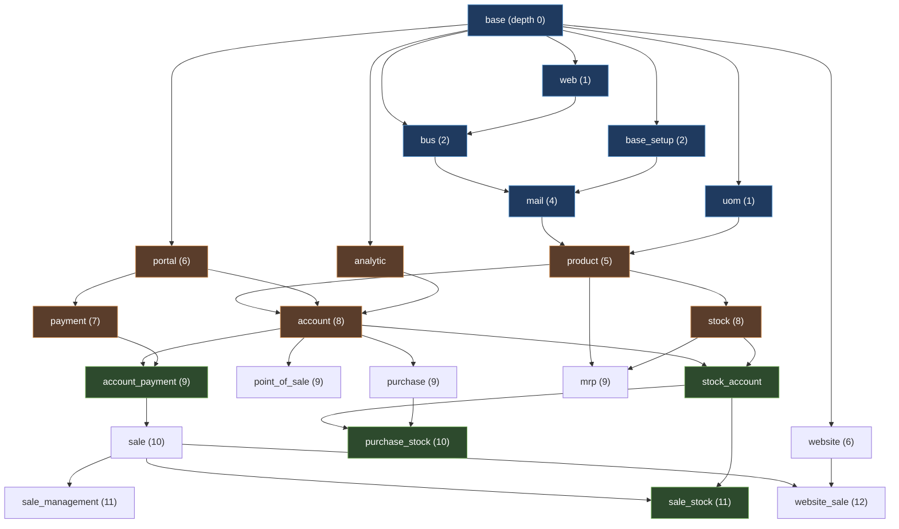

# 01 - Module Architecture Map

Phase 1 output. Source: `__manifest__.py` of all 693 installable-indexed modules,
parsed with `ast.literal_eval` (0 errors).

## Census

| Metric | Value |
|---|---|
| Manifests parsed | 693 |
| Parse errors | 0 |
| Declared applications (`application: True`) | 34 |
| `auto_install` modules (glue/bridge) | 401 |
| Non-installable | 1 (`iot_drivers`) |
| Max dependency depth from `base` | 16 |

**The single most important ratio here: 401 of 693 modules (58%) are
`auto_install` glue.** Odoo's ecosystem is not 693 features. It is roughly 290
features plus 401 bridges that activate automatically when two features are
both present. `sale_stock` is the archetype: it exists only to connect `sale`
and `stock_account`, and installs itself the moment both are present.

## Domain breakdown

By the first segment of the manifest `category`:

| Modules | Domain | Reading |
|---|---|---|
| 258 | Accounting | Dominated by localization: 127 Account Charts, 34 EDI, 27 Localizations, 22 Payment Providers |
| 99 | Sales | 38 Sales/Sales, 36 Point of Sale, 12 CRM |
| 86 | Hidden | 42 Hidden, 25 Hidden/Tools, 19 Hidden/Tests |
| 40 | Marketing | 17 Events, 13 Email Marketing |
| 40 | Website | 33 Website/Website |
| 36 | Theme | Pure presentation packages |
| 34 | Supply Chain | 13 Purchase, 12 Inventory |
| 29 | Productivity | 14 Dashboard |
| 29 | Human Resources | |
| 16 | Services | 12 Project |
| 7 | Uncategorized | |
| 18 | (long tail of malformed/one-off categories) | Includes literal strings like `Send sms to customer for order confirmation`, i.e. a category field misused as a description |

**Inference:** the Accounting count overstates functional weight. 161 of those
258 are country charts and EDI formats with near-identical structure. The
functional accounting core is the 20 modules in `Accounting/Accounting`.

## The 34 applications

```
account          calendar         contacts        crm             data_recycle
fleet            hr               hr_attendance   hr_expense      hr_holidays
hr_recruitment   hr_skills        im_livechat     lunch           mail
maintenance      marketing_card   mass_mailing    mass_mailing_sms
mrp              point_of_sale    pos_restaurant  project         project_todo
purchase         repair           sale_management stock           survey
website          website_event    website_hr_recruitment          website_sale
website_slides
```

## Dependency layers

Depth = longest path to a module with no in-tree dependencies.

| Depth | Modules | Character |
|---|---|---|
| 0 | 4 | `base`, `base_report_wkhtmltox`, `iot_drivers`, `test_data_module` |
| 1 | 14 | `web`, `uom`, `rpc`, `printer`, `social_media`, `base_sparse_field`, `l10n_fr`, `populate` + test harnesses |
| 2 | 24 | `bus`, `barcodes`, `base_setup`, `base_import`, `http_routing`, `resource`, `utm`, `auth_totp`, `web_tour` |
| 3 | 17 | |
| 4 | 4 | includes `mail` |
| 5 | 25 | includes `product` |
| 6-7 | 26 | includes `payment` (7) |
| 8 | 39 | includes `account`, `stock` |
| 9 | 163 | the widest layer: `purchase`, `mrp`, `point_of_sale`, `account_payment` |
| 10 | 153 | `sale`, `purchase_stock` |
| 11 | 92 | `sale_management`, `sale_stock` |
| 12 | 66 | `website_sale` |
| 13 | 43 | |
| 14 | 18 | |
| 15 | 4 | |
| 16 | 1 | deepest module in the tree |

**Observation:** 408 of 693 modules (59%) sit at depth 9-11. The graph is not a
tree with even branching; it is an hourglass. Everything funnels through a
narrow waist at depth 8 (`account`, `stock`) and then fans out.

## Hub modules (direct dependents)

| Dependents | Module | Role |
|---|---|---|
| 157 | `account` | The real center of gravity |
| 56 | `website` | |
| 47 | `point_of_sale` | |
| 44 | `mail` | Messaging/activity substrate |
| 41 | `account_edi_ubl_cii` | UBL/CII e-invoicing base, consumed by every EDI localization |
| 40 | `base` | |
| 34 | `web` | |
| 25 | `payment`, `sale` | |
| 20 | `base_setup` | |
| 18 | `sms` | |
| 17 | `digest`, `l10n_syscohada`, `portal` | `l10n_syscohada` is the shared West-African chart base |
| 16 | `crm` | |
| 15 | `hr`, `mass_mailing`, `website_sale` | |

**`account` having 4x the dependents of `base` is the single most
load-bearing fact about this codebase.** Anything that touches money depends on
`account`, and in Odoo almost everything touches money. A change to
`account.move` has a blast radius of 114 extending modules (see
[02](02-orm-framework-mechanics.md)).

## Topology



Green nodes are `auto_install` bridges: they have no user-facing purpose and
exist solely to reconcile two cores.

## Canonical dependency declarations

Read directly from each manifest's `depends`. Note how terse they are: Odoo
relies on transitive resolution rather than listing the full closure.

| Module | Depth | Dependents | `depends` |
|---|---|---|---|
| `base` | 0 | 40 | `[]` |
| `mail` | 4 | 44 | `base`, `base_setup`, `bus`, `html_editor`, `web_tour` |
| `product` | 5 | 7 | `base`, `mail`, `uom` |
| `payment` | 7 | 25 | `onboarding`, `portal` |
| `account` | 8 | 157 | `analytic`, `base_setup`, `digest`, `onboarding`, `portal`, `product` |
| `stock` | 8 | 11 | `barcodes_gs1_nomenclature`, `digest`, `product` |
| `purchase` | 9 | 8 | `account` |
| `mrp` | 9 | 11 | `product`, `resource`, `stock` |
| `point_of_sale` | 9 | 47 | `account`, `barcodes_gs1_nomenclature`, `base_report_wkhtmltox`, `digest`, `google_address_autocomplete`, `html_editor`, `iot_webserial`, `phone_validation`, `product`, `resource` |
| `account_payment` | 9 | 5 | `account`, `payment` |
| `sale` | 10 | 25 | `account_payment`, `sales_team`, `utm` |
| `purchase_stock` | 10 | 8 | `purchase`, `stock_account` |
| `sale_management` | 11 | 9 | `digest`, `sale` |
| `sale_stock` | 11 | 11 | `sale`, `stock_account` |
| `website_sale` | 12 | 15 | `delivery`, `digest`, `html_builder`, `portal_rating`, `sale`, `website`, `website_mail`, `website_payment` |

**Note on `sale`:** it depends on `account_payment`, not on `account`
directly. Selling in Odoo 20 presumes the payment-provider stack. This is why
`sale` sits two layers below `account` rather than one.
