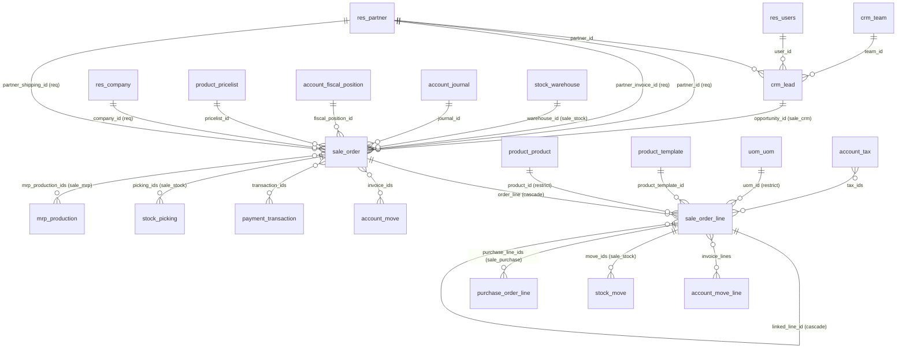
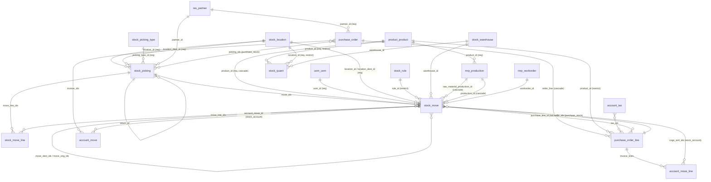
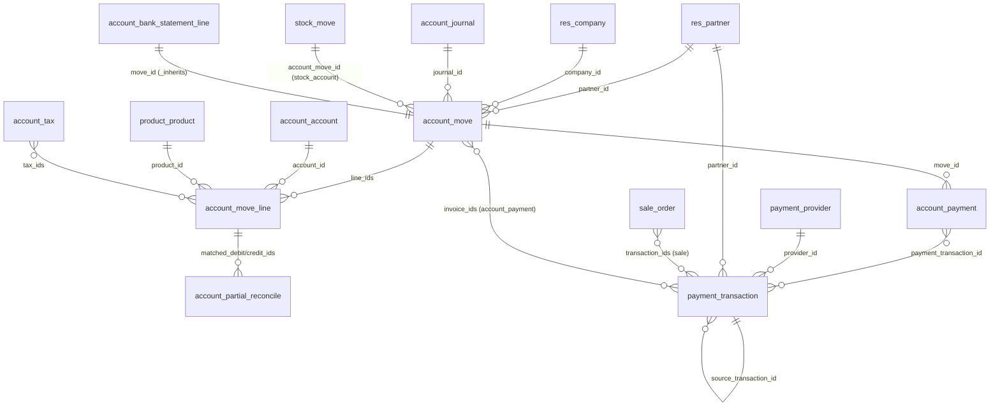

# 03 - ER Diagrams by Domain

Phase 2 output. Every relation below was read from an AST-extracted field
definition; the **Added by** column names the module whose class declares that
field. Relations with no in-scope comodel (localization-specific, archival) are
omitted for legibility, not because they are absent.

## How to read these diagrams

The decisive fact is in the **Added by** column, not the arrows. A foreign key
joining two domains is almost never declared by either domain. `stock.picking`
has a `sale_id` column, but `stock` did not create it: `sale_stock` did. This
is how Odoo keeps `stock` installable without `sale`.

| FK | On model | Points to | Added by | Not by |
|---|---|---|---|---|
| `sale_id` | `stock.picking` | `sale.order` | `sale_stock` | `stock` |
| `purchase_id` | `stock.picking` | `purchase.order` | `purchase_stock` | `stock` |
| `pos_order_id` | `stock.picking` | `pos.order` | `pos_stock` | `stock` |
| `production_ids` | `stock.picking` | `mrp.production` | `mrp` | `stock` |
| `sale_line_id` | `stock.move` | `sale.order.line` | `sale_stock` | `stock` |
| `purchase_line_id` | `stock.move` | `purchase.order.line` | `purchase_stock` | `stock` |
| `account_move_id` | `stock.move` | `account.move` | `stock_account` | `stock` |
| `opportunity_id` | `sale.order` | `crm.lead` | `sale_crm` | `sale` |
| `order_ids` | `crm.lead` | `sale.order` | `sale_crm` | `crm` |
| `mrp_production_ids` | `sale.order` | `mrp.production` | `sale_mrp` | `sale` |
| `sale_line_id` | `purchase.order.line` | `sale.order.line` | `sale_purchase` | both |

**Inference:** the dependency graph in [01](01-module-architecture-map.md) and
the ER graph are deliberately different shapes. The data model is far more
connected than the module graph, and every extra edge is paid for by a bridge
module.

## Sales and CRM



| Model | Fields | Extended by | Computes | Mixins |
|---|---|---|---|---|
| `crm.lead` | 94 | 12 | 41 | `mail.thread.subject.suggested`, `mail.thread.blacklist`, `mail.thread.phone`, `mail.activity.mixin`, `utm.mixin`, `format.address.mixin` |
| `sale.order` | 175 | 44 | 101 | `pos.load.mixin`, `account.document.import.mixin`, `mail.activity.mixin`, `mail.thread.subject.suggested`, `portal.mixin`, `product.catalog.mixin` |
| `sale.order.line` | 134 | 36 | 87 | `analytic.mixin`, `pos.load.mixin`, `product.catalog.line.mixin`, `website.checkout.alert.mixin` |

`sale.order` carries **three** partner FKs (`partner_id`,
`partner_invoice_id`, `partner_shipping_id`), all required. Sold-to, bill-to,
and ship-to are modeled as separate contacts rather than addresses on one
contact. `sale.order.line.linked_line_id` is a self-reference with
`ondelete='cascade'`, used for optional-product and bundle lines: deleting the
parent line removes its accessories.

## Supply chain: inventory, purchase, manufacturing



| Model | Fields | Extended by | Computes | State values |
|---|---|---|---|---|
| `stock.picking` | 158 | 28 | 54 | `draft`, `waiting`, `confirmed`, `assigned`, `done`, `cancel` |
| `stock.move` | 128 | 31 | 75 | + `partially_available` |
| `stock.move.line` | 54 | 9 | 13 | - |
| `stock.quant` | 37 | 4 | 11 | - |
| `purchase.order` | 74 | 15 | 38 | `draft`, `sent`, `to approve`, `purchase`, `cancel` |
| `purchase.order.line` | 67 | 12 | 24 | - |
| `mrp.production` | 103 | 9 | 54 | `draft`, `confirmed`, `progress`, `to_close`, `done`, `cancel` |
| `mrp.workorder` | 60 | 2 | 19 | `blocked`, `ready`, `progress`, `done`, `cancel` |

### `procurement.group` is gone

**Observation:** the model `procurement.group` does **not exist** anywhere in
the 693 indexed modules, and `stock.move` has no `group_id` field. Both were
long-standing fixtures of Odoo's procurement engine.

Procurement is now a plain in-memory tuple, defined at
`stock/models/stock_rule.py:31`:

```python
class Procurement(NamedTuple):
    product_id: fields.Many2one
    product_qty: fields.Float
    uom_id: fields.Many2one
    location_id: fields.Many2one
    name: fields.Char
    origin: fields.Char
    company_id: fields.Many2one
    values: dict
```

**Inference:** procurement requests are no longer persisted as records before
being resolved. They are constructed, dispatched, and discarded within one
transaction; the durable trace is the resulting `stock.move` chain
(`move_orig_ids` / `move_dest_ids`) and `rule_id`. Anyone porting code that
read or wrote `procurement.group` must re-express it through those fields.

`stock.move` self-references do the work the group used to: `move_orig_ids`
and `move_dest_ids` form the multi-step routing chain (pick -> pack -> ship),
and `rule_id` records which `stock.rule` generated the move, with
`ondelete='restrict'` so a rule cannot be deleted out from under live moves.

## Accounting and payments



| Model | Fields | Extended by | Computes | Constrains | State values |
|---|---|---|---|---|---|
| `account.move` | 537 | 114 | 271 | 18 | `draft`, `posted`, `cancel` |
| `account.move.line` | 148 | 44 | 60 | 7 | - |
| `account.payment` | 86 | 13 | 45 | 7 | `draft`, `paid`, `reconciled`, `canceled`, `rejected` |
| `payment.transaction` | 45 | 31 | 3 | 2 | `draft`, `pending`, `authorized`, `done`, `cancel`, `error` |
| `account.journal` | 115 | 41 | - | - | - |
| `account.tax` | 115 | 48 | - | - | - |

`account.move` is the universal document: customer invoices, vendor bills,
journal entries, and POS entries are all the same model distinguished by
`journal_id` and `move_type`. `account.bank.statement.line` uses `_inherits`
delegation onto it (`move_id`), so every reconciled statement line is literally
a journal entry row.

**Note the asymmetry in `payment.transaction`:** 45 fields but only 3 compute
methods, against `account.move`'s 537 and 271. The transaction is a thin,
mostly-stored state record that 31 provider modules extend. The complexity
lives in its state transition methods (`_set_done`, `_set_authorized`,
`_set_error`, `_set_canceled` at `payment/models/payment_transaction.py`
lines 1117-1170), not in derived fields.

## Cross-domain hub models

These are shared by every domain above and are the reason `account` and `base`
dominate the dependency graph.

| Model | Fields | Extended by | Defined in |
|---|---|---|---|
| `res.config.settings` | 784 | 134 | `base` |
| `res.company` | 497 | 124 | `account`, `base`, `l10n_sg`, `point_of_sale` |
| `res.partner` | 305 | 117 | `base`, `bus`, `mail`, `phone_validation`, `point_of_sale`, `website`, `website_partner` |
| `product.template` | 190 | 56 | `point_of_sale`, `product`, `website_sale` |
| `res.users` | 162 | 52 | `base`, `bus`, `mail`, `point_of_sale` |
| `product.product` | 112 | 36 | `point_of_sale`, `product`, `website_sale` |
| `hr.employee` | 205 | 18 | `hr`, `pos_hr` |

`product.product` delegates to `product.template` via `product_tmpl_id`
(`_inherits`), and `res.users` delegates to `res.partner` via `partner_id`. A
user row therefore owns a partner row, which is why `res.partner` is extended
by 117 modules: everything that touches a user, a customer, a vendor, or an
employee contact lands on it.
