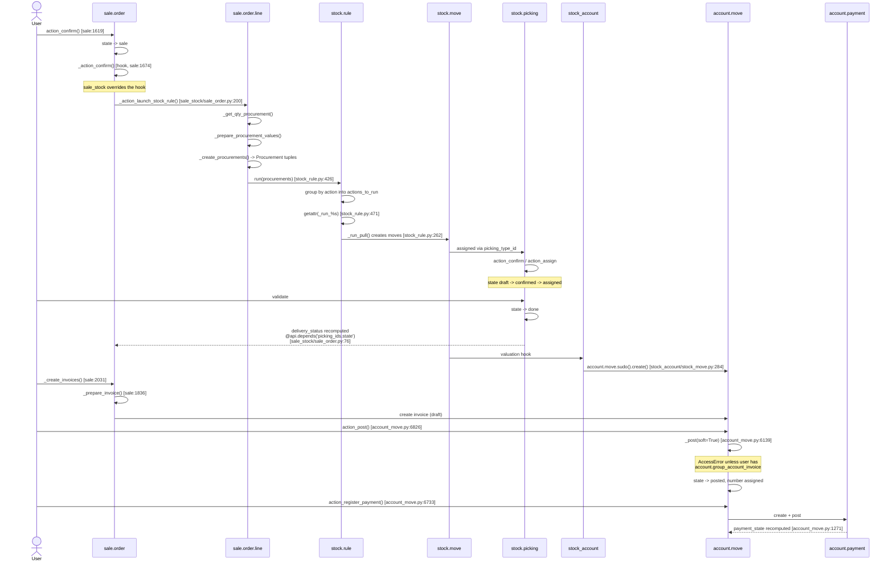
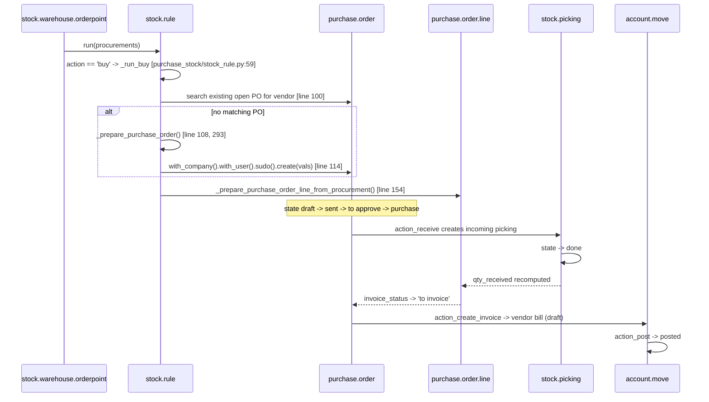
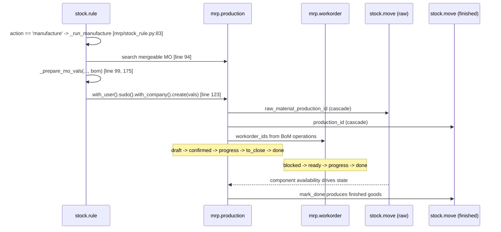
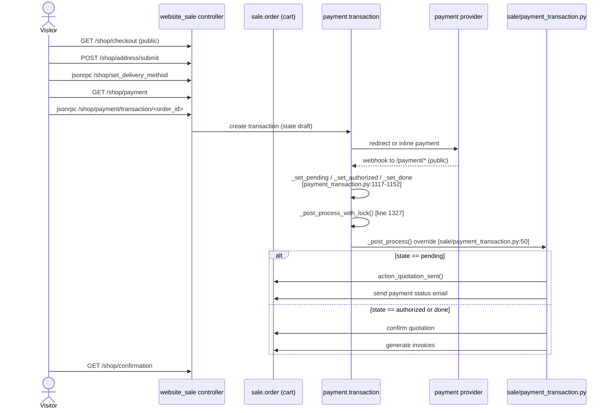

# 04 - Cross-Module Business Workflows

Phase 3 output. Call chains were read from source; **no workflow was executed**.
Ordering within a transaction is an inference from call-site position, not an
observation.

## The integration mechanism

Odoo has no event bus and no message broker between modules. Cross-module
behavior rests on exactly two devices.

### Device 1: the empty hook

A core module declares a method that does nothing, purely so bridges can
override it. In `sale/models/sale_order.py:1674`:

```python
def _action_confirm(self):
    """Provide a hook method between confirmation and lock/confirmation mail generation."""
```

The docstring is the entire body. `sale_stock` then fills it
(`sale_stock/models/sale_order.py:198`):

```python
def _action_confirm(self):
    self._update_delivery_partner_company()
    self.order_line._action_launch_stock_rule()
    return super(SaleOrder, self)._action_confirm()
```

`sale` never references `stock`. The dependency points one way only, and the
bridge owns the edge.

### Device 2: dynamic dispatch by method name

`stock/models/stock_rule.py:471`:

```python
if hasattr(self.env['stock.rule'], '_run_%s' % action):
    getattr(self.env['stock.rule'], '_run_%s' % action)(procurements)
else:
    _logger.error("The method _run_%s doesn't exist on the procurement rules" % action)
```

The rule's `action` field value is concatenated into a method name. A module
registers a procurement strategy **by defining a method**. Measured
implementors across the whole ecosystem:

| Handler | Module | Creates |
|---|---|---|
| `_run_pull` | `stock` (`stock_rule.py:262`) | `stock.move` (internal transfer) |
| `_run_buy` | `purchase_stock` (`stock_rule.py:59`) | `purchase.order` + lines |
| `_run_manufacture` | `mrp` (`stock_rule.py:83`) | `mrp.production` |

Three handlers, three modules, zero coupling. `stock` does not know `mrp` or
`purchase` exist. Installing `mrp` makes "manufacture" a valid routing action
system-wide.

**This single `getattr` is the most load-bearing line in the supply chain.**
It is also the failure mode: a misconfigured `stock.rule.action` logs an error
and silently fulfills nothing, rather than raising.

## Order to cash



### Verified anchors

| Step | Citation |
|---|---|
| `action_confirm` | `sale/models/sale_order.py:1619` |
| `_action_confirm` empty hook | `sale/models/sale_order.py:1674` |
| `sale_stock` override | `sale_stock/models/sale_order.py:198-201` |
| `_action_launch_stock_rule` | `sale_stock/models/sale_order_line.py:377` |
| `stock.rule.run` | `stock/models/stock_rule.py:426` |
| dynamic dispatch | `stock/models/stock_rule.py:471` |
| `_run_pull` | `stock/models/stock_rule.py:262` |
| delivery status back-propagation | `sale_stock/models/sale_order.py:76` |
| stock valuation creates journal entry | `stock_account/models/stock_move.py:284` |
| `_create_invoices` | `sale/models/sale_order.py:2031` |
| `_prepare_invoice` | `sale/models/sale_order.py:1836` |
| `action_post` / `_post` | `account/models/account_move.py:6826` / `6139` |
| `action_register_payment` | `account/models/account_move.py:6733` |
| `_compute_payment_state` | `account/models/account_move.py:1271` |

**Observed guard in `_post`** (`account_move.py:6153`):

```python
if not self.env.su and not self.env.user.has_group('account.group_account_invoice'):
    raise AccessError(_("You don't have the access rights to post an invoice."))
```

Posting is gated in Python, independently of the `ir.access` layer. The
docstring also records that a journal locked with a hash table makes some
fields immutable afterwards, which is the audit-trail mechanism.

## Procure to pay



`_run_buy` **merges into an existing purchase order** when one is open for the
same vendor (`purchase_stock/models/stock_rule.py:100`) rather than always
creating a new one. Note the `.sudo()` at line 114: the PO is created with
elevated rights because the triggering user (or the scheduler) may have no
purchase permissions. This is deliberate and is why procurement can run from a
cron.

## Manufacturing



Both component and finished moves use `ondelete='cascade'` to the production
order, so deleting an MO removes its entire move set. `mrp` also adds
`production_ids` to `stock.picking`, linking transfers back to manufacturing.

## Online checkout (website_sale to payment)



Three modules override `_post_process` on the same transaction, each adding its
own domain's reaction:

| Override | File |
|---|---|
| base | `payment/models/payment_transaction.py:1345` |
| sales | `sale/models/payment_transaction.py:50` |
| accounting | `account_payment/models/payment_transaction.py:98` |

`_post_process_with_lock` (`payment_transaction.py:1327`) wraps the chain,
which matters because the trigger is an external webhook: the same provider
notification can arrive twice. The lock is the idempotency boundary.

**Inference, not observation:** the `sale` override calls `super()` only inside
the `pending` branch in the code read. Transactions in other states follow
different paths through the override. Confirming the exact super()-call
ordering for every state requires reading the full method body, which this pass
did not do exhaustively.

## Workflow summary table

| Flow | Trigger | Dispatch | Terminal records |
|---|---|---|---|
| Order to cash | `sale.order.action_confirm` | `_action_confirm` hook -> `_run_pull` | `stock.picking` done, `account.move` posted, `account.payment` reconciled |
| Procure to pay | orderpoint / SO procurement | `_run_buy` | `purchase.order` purchase, incoming picking done, vendor bill posted |
| Make to order | SO or orderpoint procurement | `_run_manufacture` | `mrp.production` done |
| Online checkout | HTTP webhook | `_post_process` chain | `payment.transaction` done, SO confirmed, invoice generated |
| Stock valuation | `stock.move` done | valuation hook | `account.move` (COGS/inventory) |

## Residual unknowns

Carried forward honestly rather than closed:

1. **`sale.order.state` selection values** were not captured by the extraction
   (see [02](02-orm-framework-mechanics.md)). The action methods exist; the
   literal state list is unverified.
2. **Transaction ordering within a flush** is inferred from call position. Odoo
   defers recomputation, so the real sequence of compute execution was not
   observed.
3. **`base.automation` rules** can inject arbitrary steps into any of these
   flows and are database records, invisible here.
4. **Enterprise flows are absent**: subscription billing, field service, and
   payroll are not in this install and therefore not in any diagram above.
